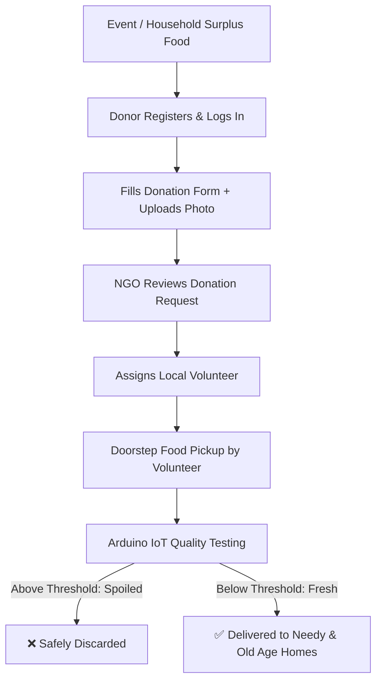
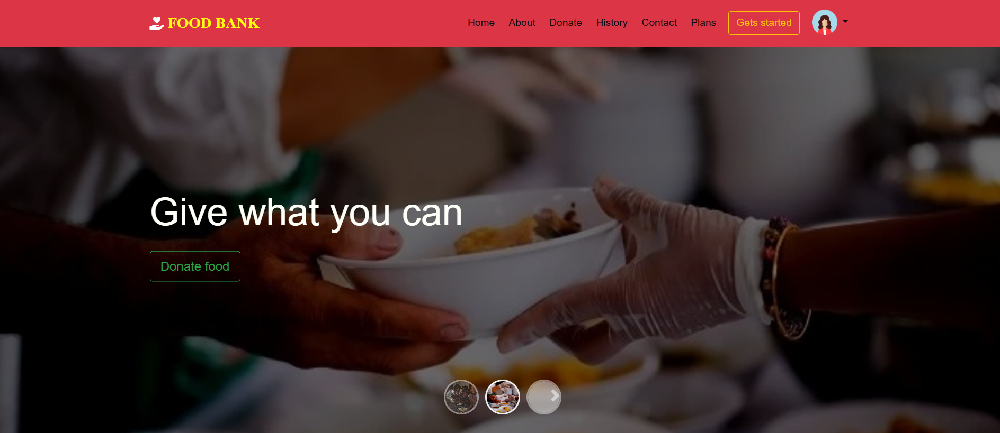
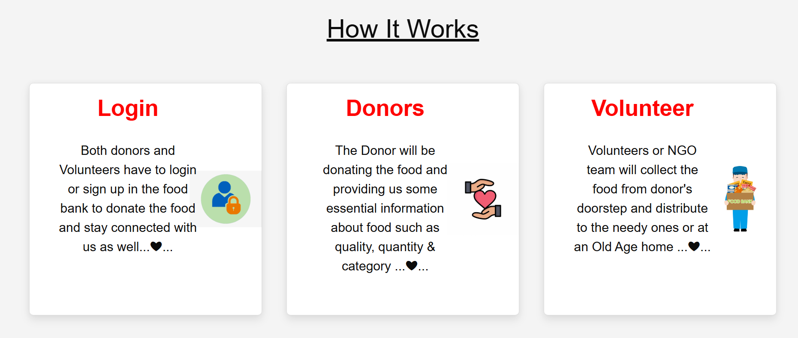
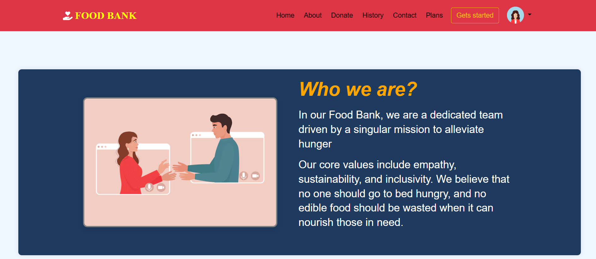
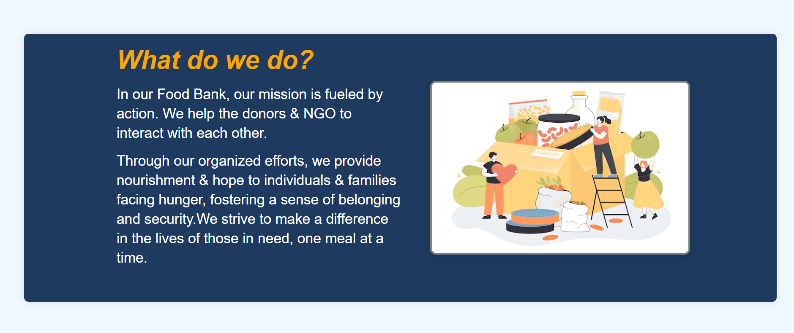
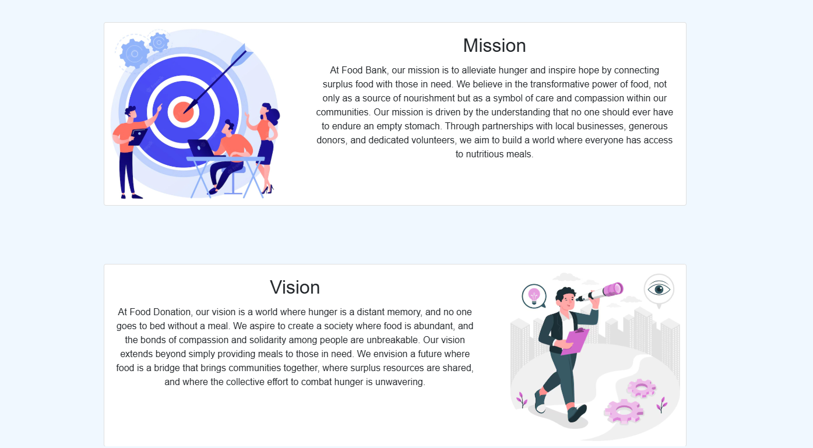
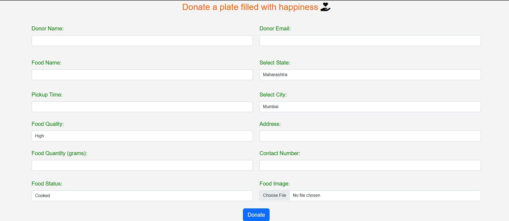
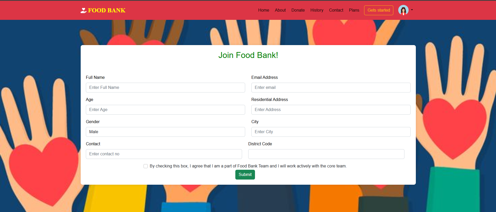
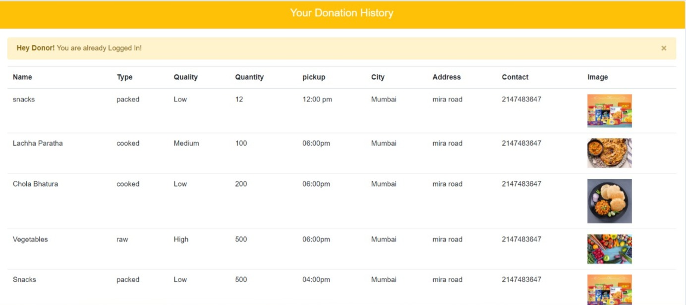

# 🍲 Food Bank — Surplus Food Donation & IoT Quality Assurance System

A web-based food donation platform connecting donors with NGOs, volunteers, and people in need. The system prevents food wastage by enabling households and event hosts to donate surplus food, featuring door-to-door volunteer collection and an **Arduino-based IoT food spoilage detection system** to ensure only safe, consumable food reaches recipients.

---

## 📌 Project Overview

Millions of tons of edible food are wasted daily at weddings, parties, and household events, while countless people struggle with hunger. **Food Bank** bridges this gap by creating an organized logistics pipeline:

1. **Donors** submit surplus food details (cooked/raw, quantity, photos, pickup address).
2. **NGOs & Admins** review donation requests and dispatch nearby volunteers.
3. **Volunteers** pick up food directly from the donor's doorstep.
4. **Arduino IoT Quality Check** tests the food condition against safety thresholds:
   - 🟢 **Below Threshold**: Food is fresh and safe ➔ distributed to shelters and old age homes.
   - 🔴 **Above Threshold**: Food is spoiled/unsafe ➔ safely discarded.

---

## ✨ Key Features

- **User & Donor Portal**:
  - Secure user registration and login.
  - Comprehensive donation form with food type (Cooked, Raw, Packed), quantity (in grams), pickup address, time slot, and food photo upload.
  - **Donation History**: Track past donation records with images, timestamps, and status.

- **Volunteer Management**:
  - Dedicated volunteer registration portal with demographic, contact, and district details.
  - Doorstep pickup assignment system coordinated by NGOs.

- **Admin & NGO Operations**:
  - Central dashboard to oversee registered donors, active volunteers, and incoming donations.
  - Real-time coordination and verification.

- **🔬 IoT Food Quality Detection (Arduino Module)**:
  - Integrated sensor-based testing (e.g., MQ Gas/Spoilage sensor, temperature/humidity).
  - Automated threshold verification prevents distribution of contaminated or expired food.

---

## 🔄 System Workflow



📸 Screenshots

**1. Home Page & How It Works:**
Landing page explaining the core mission and the 3-step process (Login, Donors, Volunteers).



**2. About Us, Mission & Vision:**
Highlighting core values: empathy, sustainability, and zero-waste food rescue.




**3. Food Donation Portal:**
Form where donors enter food details, quality, quantity in grams, status (Cooked/Raw), pickup schedule, and address.


**4. Volunteer Registration & User Login:**
Volunteer onboarding form to join the Food Bank team, alongside secure login.


**5. Donor Past History:**
Table showing donor's past contributions, pickup times, addresses, and uploaded food images.


🛠️ Tech Stack:- \
\
Frontend: HTML5, CSS3, JavaScript, Bootstrap\
Backend: PHP (XAMPP / Apache)\
Database: MySQL (phpMyAdmin)\
Hardware / IoT: Arduino Uno , Nano, Breadboard Gas Sensor (MQ-4 / MQ-135)\
🗄️ Database Setup (schema.sql)\
1.Open your browser and navigate to phpMyAdmin:

```bash
http://localhost/phpmyadmin
```

2.Create a new database named newfood. \
3.Click the Import tab. \
4.Choose the database/schema.sql file from this repository. \
5.Click Import (or Go) at the bottom.\

**🚀 Local Installation & Setup**

**Prerequisites**

- XAMPP (Apache + MySQL)
- Git installed on your system
- Web browser (Chrome, Edge, Firefox)

**Step-by-Step Setup** \
**1. Clone the repository** into your XAMPP **htdocs** directory: \

```bash
cd C:/xampp/htdocs
git clone https://github.com/YOUR_USERNAME/NewFood.git foodbank
```

**2. Start XAMPP:**

- Open XAMPP Control Panel.
- Start both Apache and MySQL.

**3. Configure Database Connection:**

- Open code.php (or your database configuration file).
- Ensure your MySQL credentials match your local setup:

```bash
$host = "localhost";
$user = "root";
$password = ""; // leave blank if default XAMPP
$dbname = "foodbank";
```

**4. Run the Application:**

- Open your browser and visit:

```bash
http://localhost/foodbank/
```

**🔌 Arduino IoT Quality Testing Setup**

1. Connect the gas/food freshness sensor (MQ series) to the Arduino analog pin (A0).
2. Calibrate sensor threshold values for organic volatile compounds / spoiled food odor.
3. Food is verified prior to dispatch:
   - Value ≤ Threshold: Pass (Safe for consumption)
   - Value > Threshold: Fail (Hazardous / Discard)

---


